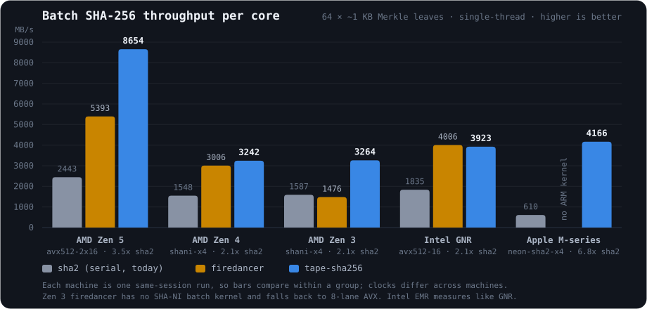

# Benchmarks

`tape-sha256` is optimized for two workloads: hashing many independent
messages and advancing many independent SHA-256 chains. Results vary by CPU,
so comparisons below use binaries built and measured on the same machine.



## Summary

| hardware | selected backend | vs `sha2` | vs Firedancer |
|---|---|---:|---:|
| AMD Zen 5 | `avx512-2x16` | 3.5x | 60% faster |
| AMD Zen 4 | `shani-x4` | 2.1x | ~8% faster |
| AMD Zen 3 | `shani-x4` | 2.1x | ~2.2x faster |
| Intel Emerald / Granite Rapids | `avx512-16` | 2.0–2.1x | 2–12% slower in measured runs |
| Apple M-series | `neon-sha2-x4` | 6.8x | not available |

These are single-core batch-hashing results, not whole-application speedups.
Absolute throughput varies with clock speed and system load; same-session
ratios are the meaningful comparison.

## Batch hashing

### Workload and methodology

The primary workload is one Solana erasure batch of Merkle leaves: 64 messages
(32 data and 32 coding shreds), each containing a 26-byte domain-separation
prefix and approximately 1 KiB of payload, for 67,680 bytes per batch.

Reported times are the best of 15 rounds of 50 iterations from:

```sh
cargo bench --bench merkle_leaves
```

Unless explicitly noted, every result uses one thread pinned to one physical
core of an otherwise idle machine, with its SMT sibling idle. Firedancer and
isa-l_crypto were built from source on the machine being tested.

The `sha2` baseline hashes one leaf at a time. Firedancer requires contiguous
messages, so its harness constructs `prefix || leaf` outside the timed region.
`tape-sha256` reads the prefix and body directly from separate slices. The
comparison therefore measures hashing rather than input preparation.

### AMD Zen 5

AMD family `0x1a`, measured 2026-08-08. The exact processor model was not
captured.

```text
implementation                     us/batch     MB/s
sha2 (serial)                         27.71      2443
tape serial                           109.77       617
tape portable-8                       255.13       265
tape avx2-8                            29.34      2307
tape shani-x4                          14.76      4584
tape avx512-16                         10.82      6254
tape avx512-2x16                        7.82      8654
Firedancer avx-8                       24.97      2711
Firedancer avx512-16                   12.55      5393
isa-l_crypto avx512-16                 10.92      6195
isa-l_crypto avx512-ni-16              10.85      6237
isa-l_crypto dispatched                10.89      6213
```

The selected `avx512-2x16` backend interlaces two 16-lane compressions. It is
3.54x faster than `sha2`, 38% faster than the single AVX-512 wave, 60% faster
than Firedancer, and 39% faster than the best isa-l_crypto result in this run.
Three pinned invocations measured 7.82, 8.30, and 8.34 us per batch.

At 7.82 us, the backend processes 8.18 million hashes or 139 million SHA-256
block compressions per second on one core. The compression figure is more
portable because hashes per second depends on message length.

### AMD Zen 4

EPYC 9B14, GCP c3d:

```text
implementation                     us/batch     MB/s
sha2 (serial)                         43.71      1548
tape shani-x4                          20.88      3242
tape avx512-16                         23.79      2845
Firedancer avx-8                       27.93      2423
Firedancer avx512-16                   22.51      3006
```

The selected SHA-NI backend is 2.09x faster than `sha2` and about 8% faster
than Firedancer's best result. Zen 4 executes 512-bit operations through a
256-bit datapath; the 2x16 interlace measured neutral here, so dispatch uses
`shani-x4`.

### AMD Zen 3

EPYC 7B13, GCP c2d:

```text
implementation                     us/batch     MB/s
sha2 (serial)                         42.66      1587
tape shani-x4                          20.73      3264
tape avx2-8                            46.81      1446
Firedancer avx-8                       45.87      1476
```

The selected SHA-NI backend is 2.06x faster than `sha2` and about 2.2x faster
than Firedancer. AVX2 loses to serial SHA-NI on this processor, which is why
runtime dispatch selects `shani-x4`.

### Intel Emerald Rapids

Xeon Platinum 8581C, GCP c4:

```text
implementation                     us/batch     MB/s
sha2 (serial)                         49.18      1376
tape shani-x4                          41.04      1649
tape avx512-16                         24.49      2763
Firedancer avx-8                       29.20      2318
Firedancer avx512-16                   21.82      3102
```

This older run came from a machine clocking about 15% lower than later Intel
runs, so only its within-session ratios should be compared. The selected
AVX-512 backend is 2.01x faster than `sha2`; Firedancer is about 12% faster in
wall time in this run.

### Intel Granite Rapids

Xeon 6985P-C, GCP c4-standard-8-lssd:

```text
implementation                     us/batch     MB/s
sha2 (serial)                         36.87      1835
tape serial                           167.08       405
tape portable-8                       308.31       220
tape shani-x4                          29.20      2318
tape avx2-8                            44.11      1534
tape avx512-16                         17.25      3923
tape avx512-2x16                       17.52      3864
Firedancer avx-8                       22.56      2999
Firedancer avx512-16                   16.89      4006
```

The selected AVX-512 backend is 2.14x faster than `sha2`. Across six paired
runs, Firedancer led by 1.3% in cycles and 2.2% in wall time:

```text
implementation             cycles/block-step     IPC     GHz
tape avx512-16                     1048            2.13    4.12
tape avx512-2x16                   1004            2.47    3.68
Firedancer avx512-16               1034            2.17    4.12
```

The interlaced backend uses fewer cycles but lowers the processor clock enough
to lose in wall time. It also varied from 17.61 to 20.15 us across ten process
invocations, with results correlated to process memory layout. Intel dispatch
therefore uses the stable single-wave backend.

### Apple M-series

```text
implementation                     us/batch     MB/s
sha2 (software path)                 110.95       610
tape neon-4                           53.44      1267
tape neon-sha2-x4                     16.25      4166
```

The selected ARM SHA-2 backend keeps four hardware streams in flight and is
6.8x faster than the `sha2` software path. Firedancer does not provide an
AArch64 batch kernel.

### Backend selection notes

- `avx512-2x16` is enabled only on AMD family `0x1a` (Zen 5). It wins on Zen 5,
  is neutral on Zen 4, and loses wall time on the tested Intel processors.
- Rounds 16–64 of the interlaced kernel remain rolled. Full unrolling grew the
  kernel close to Zen 5's 32 KiB L1 instruction-cache limit and made results
  depend on code placement.
- On Zen 5, `-C target-cpu=native` made the interlaced kernel 8–14% slower in
  measured runs. It is not recommended for this crate without re-benchmarking
  the target workload.

## Hash chains

`hash_chain` advances one serial chain using the CPU SHA-256 unit.
`hash_chains` advances independent chains in parallel. Results below are
nanoseconds per link from `cargo bench --bench poh_chain`:

| chains per call | AMD Zen 5 | Apple M-series |
|---|---:|---:|
| `sha2`, serial baseline | 45.4 | 27.7* |
| 1 (`hash_chain`) | 33.8 | 22.5 |
| 4 | 18.9 | 14.5 |
| 32 | 7.3 | 14.5 |

\* The Apple `sha2` result uses its `asm` feature; without it, the baseline is
approximately 105 ns per link.

Zen 5 reaches 6.0x the `sha2` baseline with enough independent chains. Apple
M-series saturates at about 1.55x because its crypto extension exposes four
efficient streams. `hash_chains` automatically steps down to narrower kernels
for small batches.

## SMT sibling scaling

Two caller-managed threads can hash separate halves of a batch on the two SMT
siblings of one physical core:

```text
hardware            two threads     one thread     speedup
AMD Zen 5               9.53 us        14.15 us       1.48x
AMD Zen 4              20.16 us        23.66 us       1.17x
Intel Emerald Rapids   20.77 us        23.88 us       1.15x
```

This measures otherwise-idle sibling capacity, not ordinary multicore
parallelism. The library does not create or pin threads, and the gain disappears
when the sibling is busy. Verify that both threads are pinned to different
logical CPUs belonging to the same physical core before trusting this result.

## Portable fallback

Scalar multi-buffer performance depends on the architecture's register count:

```text
implementation                x86-64 (Zen 4)     AArch64 (Apple M)
tape serial-1                     218.30 us              106.5 us
tape portable-2                   368.66 us                  —
tape portable-4                   365.01 us                  —
tape portable-8                   418.78 us               93.7 us
```

Eight portable lanes are 13% faster than serial on AArch64 but substantially
slower on x86-64 because of register spills. Runtime dispatch therefore uses
`portable-8` on AArch64 and `portable-1` elsewhere when SIMD is unavailable.

## WebAssembly

For approximately 1 KiB messages in a browser, hardware-backed WebCrypto is
slightly faster than this crate's `simd128` backend. The WebAssembly backend is
more useful for small messages in tight synchronous loops; one address-grinding
benchmark reached 4.55 million candidates per second, 3.7x the web3.js stack
and 1.6x `hash-wasm`.

See [benches/wasm/README.md](benches/wasm/README.md) for the full WebAssembly
methodology and results.

## Tape blob commitments

`cargo bench --bench blob_group` builds a Merkle tree over an erasure group of
up to 20 slices of up to 4 KiB. Leaves use `sha256("LEAF" || slice)` and parent
nodes use `sha256("LEFT" || left || "RIGHT" || right)`.

Apple M-series, best of 15 rounds:

```text
implementation                         us/group     MB/s
leaves: sha2 serial                      128.92       636
leaves: tape hash_many_prefixed           18.72      4381
joins: sha2 serial                         4.19       366
joins: tape hash_many                      0.72      2122
```

The leaf level is 6.9x faster, the join level is 5.8x faster, and the complete
commitment is 6.85x faster. That is approximately 51,000 slice groups or
4.2 GB of payload per second on one core.

AMD Zen 4, same-session comparison:

```text
implementation                         us/group     MB/s
leaves: sha2 serial                       50.36      1628
leaves: tape hash_many_prefixed           28.78      2850
leaves: Firedancer avx512-16              32.43      2528
joins: sha2 serial                         1.82       844
joins: tape hash_many                      1.28      1199
joins: Firedancer avx-8                    1.32      1158
```

The complete commitment takes 30.05 us with `tape-sha256` and 33.75 us with
Firedancer, making `tape-sha256` 1.12x faster. Tail routing is important for
this 20-leaf workload: sending the four-message remainder to SHA-NI instead of
a mostly empty 16-lane kernel improves the leaf level from 42.7 to 28.78 us.

## Application-level results

In Agave integration measurements, replacing serial leaf hashing made shred
recovery 14–21% faster end to end. The single-threaded SIMD path was also 1.55x
faster than the existing seven-thread Rayon pool. Shred verification improved
by 1.40x on Zen 5 in the measured receive path.

These results depend on the share of time an application spends hashing and
should not be generalized beyond the measured paths.

## Running reference comparisons

Reference implementations are available only through benchmark features; they
are not linked into the library.

To include Firedancer's AVX rows, point `FD_LIB_DIR` at a built Firedancer
library directory:

```sh
FD_LIB_DIR=/path/to/firedancer/build/linux/gcc/zen5/lib \
  cargo bench --bench merkle_leaves --features firedancer-bench
```

Add `firedancer-bench-avx512` to include AVX-512. The Firedancer build must use
a machine profile that exports the AVX-512 symbol.

To include isa-l_crypto, point `ISAL_DIR` at a built source tree or installed
prefix:

```sh
ISAL_DIR=/path/to/isa-l_crypto \
  cargo bench --bench merkle_leaves --features isal-bench
```

Every reference entry point is checked against `sha2` before it is timed.
